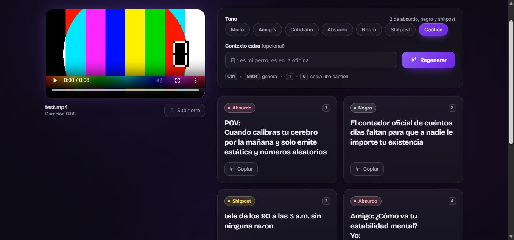
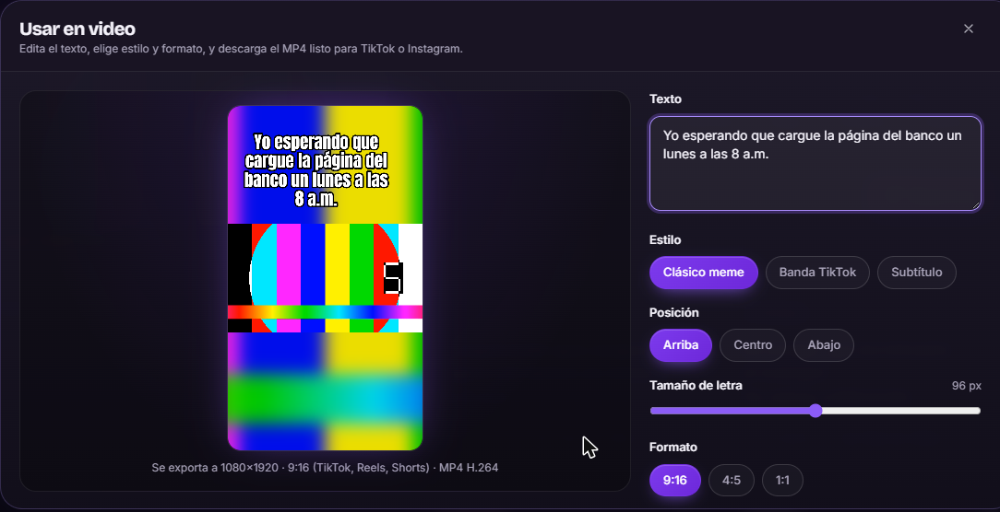

# MemeCaptioner

Herramienta web local: subes un .mp4 → FFmpeg extrae 5 frames equidistantes → un modelo con visión devuelve 6 captions tipo meme en español.



Más capturas en [`screenshots/`](screenshots/) (estado vacío, vista móvil y editor de video).

### Exportar para TikTok / Instagram

Cada caption tiene un botón **«Usar en video»** que abre un editor:

- Texto editable (respeta los saltos de línea) y 3 estilos: **Clásico meme** (blanco con borde negro, fuente Anton), **Banda TikTok** (franja blanca arriba con texto negro; el video va debajo) y **Subtítulo** (caja negra semitransparente).
- Posición arriba / centro / abajo, tamaño de letra, formato **9:16** (1080×1920), **4:5** (1080×1350) o **1:1** (1080×1080) y encaje **fondo difuminado** o **recortar**.
- Vista previa en vivo con el video reproduciéndose. El texto se dibuja en un `<canvas>` del tamaño final, con márgenes seguros en 9:16 (no tapa los botones de TikTok de la derecha ni la descripción de abajo): ese mismo canvas se envía como PNG al backend, así que lo que ves es lo que se exporta.
- «Descargar video» renderiza con FFmpeg (H.264, yuv420p, 30 fps, AAC, `+faststart`) y descarga `memecaptioner_<formato>_<fecha>.mp4`. No gasta peticiones de Gemini.



Proveedores de visión (variable `PROVIDER` en `.env`):

| `PROVIDER` | Qué necesita | Modelo por defecto |
|---|---|---|
| `gemini` (por defecto) | `GEMINI_API_KEY` (gratis en https://aistudio.google.com/apikey) | `GEMINI_MODEL=gemini-3.5-flash-lite`, respaldo ante 503: `GEMINI_FALLBACK_MODEL=gemini-2.5-flash` (otra generación, para que no se sature a la vez que el principal) |
| `ollama` | Ollama corriendo en local + `ollama pull <modelo>` con visión | `OLLAMA_MODEL=qwen2.5vl:7b`, `OLLAMA_URL=http://localhost:11434` |
| `anthropic` | `ANTHROPIC_API_KEY` | `VISION_MODEL=claude-sonnet-5-5` |

El nivel gratuito de Gemini tiene un límite de peticiones bajo: si se agota, la API responde 429 con *"Llegaste al límite gratuito de Gemini, espera un momento o intenta mañana"*.

## Estructura

```
memecaptioner/
├── .env.example
├── .gitignore
├── README.md
├── backend/
│   ├── requirements.txt
│   └── app/
│       ├── main.py            # crea la app, monta /api, /media y el frontend
│       ├── config.py          # Settings desde .env
│       ├── schemas.py         # modelos Pydantic (Tone, Angle, Caption...)
│       ├── storage.py         # disco: data/videos, data/frames y data/renders, ids, límites
│       ├── api/
│       │   └── routes.py      # endpoints (solo orquestan)
│       └── services/
│           ├── video.py       # ffprobe + ffmpeg (frames)
│           ├── render.py      # ffmpeg: video encajado en 9:16 / 4:5 / 1:1 + PNG del texto
│           ├── captioner.py   # prompt, plan de ángulos y validación
│           ├── tones.py       # tonos, ángulos y reparto de captions
│           └── providers/     # un archivo por proveedor de visión
│               ├── __init__.py    # get_provider() según PROVIDER
│               ├── base.py        # interfaz Provider + JSON schema de salida
│               ├── gemini.py      # google-genai, salida JSON con response_schema
│               ├── ollama.py      # HTTP a /api/chat con "format"
│               └── anthropic.py   # Claude con tool use forzado
├── frontend/                  # sin build: Tailwind por CDN + JS vanilla
│   ├── index.html
│   ├── styles.css             # tema oscuro, animaciones, componentes
│   └── app.js                 # interfaz: subida, tonos, captions, atajos y editor de video
├── screenshots/               # capturas para el README
└── data/
    ├── videos/                # <id>.mp4
    ├── frames/                # <id>/frame_01.jpg ...
    └── renders/               # videos exportados (se borran solos tras 1 hora)
```

## Arrancar

Requisitos: Python 3.11+ y FFmpeg en el PATH (`ffmpeg -version`).

```bash
cp .env.example .env          # y pon tu GEMINI_API_KEY (o cambia PROVIDER)
cd backend
python -m venv .venv && source .venv/bin/activate   # Windows: .venv\Scripts\activate
pip install -r requirements.txt
uvicorn app.main:app --reload --reload-dir app
```

`--reload-dir app` hace que solo se vigile el código: sin él, el reloader vigila también `.venv/` (reinicios sin motivo) y en carpetas de OneDrive puede no detectar los cambios. Si cambias el `.env`, reinicia a mano.

Abre http://127.0.0.1:8000/docs para probar la API.

## API

| Método | Ruta | Qué hace |
|---|---|---|
| GET | `/api/health` | Estado, `provider`, `model` y si el proveedor tiene API key |
| GET | `/api/tones` | Lista de tonos para el selector |
| POST | `/api/videos` | `multipart` con `file` (.mp4). Guarda, extrae frames. Devuelve `video_id`, `video_url`, `duration_s`, `frame_urls` |
| POST | `/api/videos/{id}/captions` | Body `{"tone": "mixto\|panas\|cotidiano\|absurdo\|negro\|shitpost\|caotico", "extra_context": "opcional"}`. Devuelve `model` (el que respondió), `scene_summary` + 6 `captions` `{id, angle, text}`. Llamarlo otra vez = regenerar (reutiliza los frames) |
| POST | `/api/videos/{id}/render` | `multipart`: `overlay` (PNG transparente del tamaño exacto del formato, máx. 8 MB), `format` (`9x16\|4x5\|1x1`), `fit` (`blur\|crop`), `band_height` (px de la franja de «Banda TikTok», 0 si no hay). Devuelve el `.mp4` como descarga |
| DELETE | `/api/videos/{id}` | Borra video, frames y sus renders |

Ángulos (`angle` de cada caption): `panas` (se muestra como «Amigos»), `cotidiano`, `absurdo`, `negro` y `shitpost`.

| Tono | Reparto de las 6 captions |
|---|---|
| `mixto` | 2 panas, 2 cotidiano, 2 absurdo |
| `caotico` | 2 absurdo, 2 negro, 2 shitpost |
| `panas`, `cotidiano`, `absurdo`, `negro`, `shitpost` | las 6 de ese ángulo |

En todos los tonos salvo `negro` y `shitpost` se pide al menos 1 POV y 1 diálogo.

Errores: 415 (no es .mp4; en render, el texto no es PNG), 413 (muy pesado), 422 (FFmpeg / duración en la subida; en captions, Gemini bloqueó la respuesta por sus filtros; en render, formato, encaje, franja o tamaño del PNG no válidos), 404, 429 (límite gratuito de Gemini agotado), 500 (FFmpeg no pudo renderizar), 502 (falló el proveedor de visión), 503 (Gemini saturado: el principal y el de respaldo). Todos con `{"detail": "mensaje en español"}`.
